# Hola 👋, soy Alejandro Arango Calderón, Ingeniero de Software y Datos en formación 🤖🚀

  

  
  
  
  

---

Soy **Ingeniero de Software y Datos en formación** en la IU Digital de Antioquia, con enfoque en **AI Engineering**: diseño y construyo aplicaciones que integran **modelos de lenguaje (LLMs)** sobre un backend sólido, pensado para llegar a producción. 🧠⚙️

Trabajo con **Python** para la capa de IA: pipelines **RAG**, búsqueda semántica con embeddings, orquestación con **LangChain** e integración de APIs de IA. Para el backend uso **Java (Spring Boot)** y **Go**, aplicando **SOLID**, **Clean Code** y **Arquitectura Hexagonal** para que el código sea testeable y fácil de mantener. 🤖

Mi formación en datos me ayuda a ver el sistema completo: cómo se modela, almacena y consulta la información (**PostgreSQL + pgvector**, **MySQL**, **MongoDB**) antes de que un modelo la use para responder. También he construido proyectos full stack con **Node.js + Express** y **React + Vite**. 🌐

 

### 💼 Lo que aporto a un equipo

- 🤖 **IA aplicada:** integración de LLMs en aplicaciones reales, diseño de flujos RAG y prompts orientados a resultados.
- 🏗️ **Backend bien diseñado:** APIs REST con arquitectura limpia, separación de capas y código mantenible.
- 📊 **Mirada de datos:** modelado, consultas y preparación de información para alimentar sistemas inteligentes.
- 🚀 **Aprendizaje rápido:** me adapto a nuevas herramientas y documento lo que construyo para que el equipo lo pueda retomar.

---

## ✨ Quick Facts

- 💻 **Trabajando en:** aplicaciones con LLMs y RAG en Python, y APIs backend en Java, Go y Node.js.
- 🌱 **Aprendiendo:** agentes de IA, evaluación de sistemas RAG, PostgreSQL con pgvector y despliegue con Docker.
- 🎯 **Objetivo:** crecer como **AI Engineer** construyendo sistemas de IA confiables, escalables y listos para producción.
- 🎓 **Educación:** Ingeniería de Software y Datos, IU Digital de Antioquia (en curso).
- 🤝 **Busco:** prácticas profesionales o roles junior en AI Engineering, Backend o Ingeniería de Datos.
- 📍 **Ubicación:** Medellín, Colombia · disponible para trabajo remoto.
- 📫 **Cómo contactarme:** [alejodim27@gmail.com](mailto:alejodim27@gmail.com)

---

## 🛠 Tecnologías y herramientas

Stack que he usado en proyectos personales y académicos, desde la capa de IA hasta el despliegue:

<table align="center">
  <tr>
    <th>Lenguajes</th>
    <th>Backend</th>
    <th>Frontend</th>
  </tr>
  <tr>
    <td align="center"></td>
    <td align="center"></td>
    <td align="center"></td>
  </tr>
</table>

<table align="center">
  <tr>
    <th>Bases de datos</th>
    <th>DevOps y control de versiones</th>
    <th>Herramientas y editores</th>
  </tr>
  <tr>
    <td align="center"></td>
    <td align="center"></td>
    <td align="center"></td>
  </tr>
</table>

**IA y datos:** LangChain · LLMs · RAG · AI APIs · Pandas · pgvector

---

## 📫 Contacto

  
  
  

<i>"Construyendo software que no solo procesa datos, sino que los entiende, bajo estándares de Clean Code."</i>

